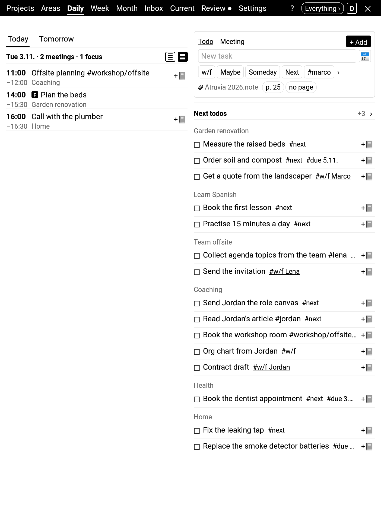
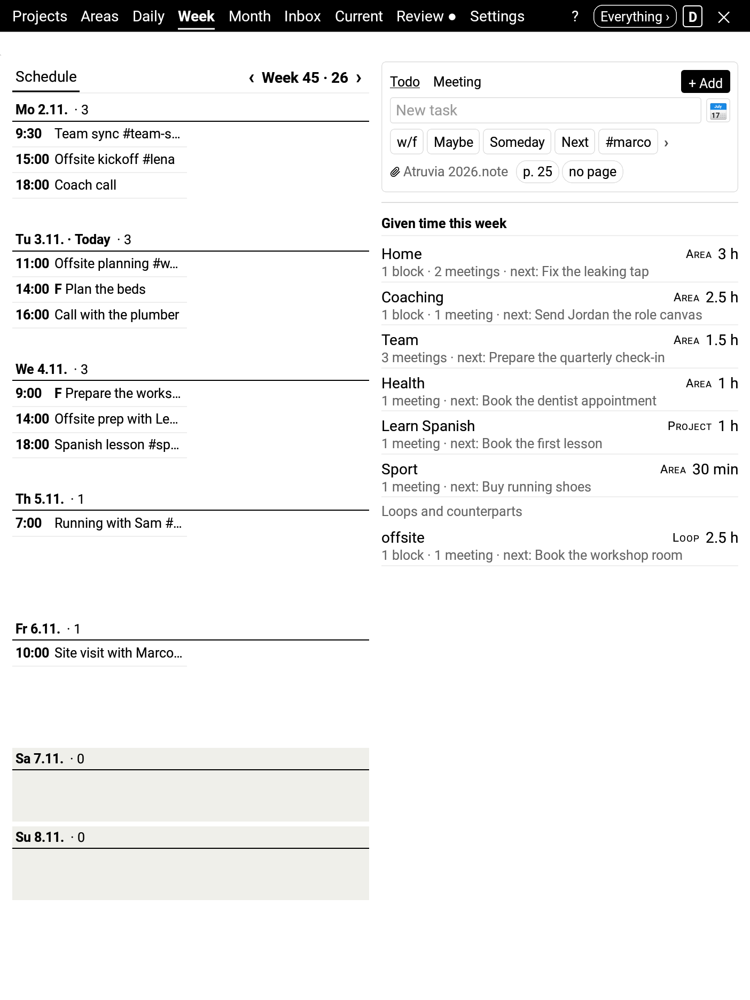
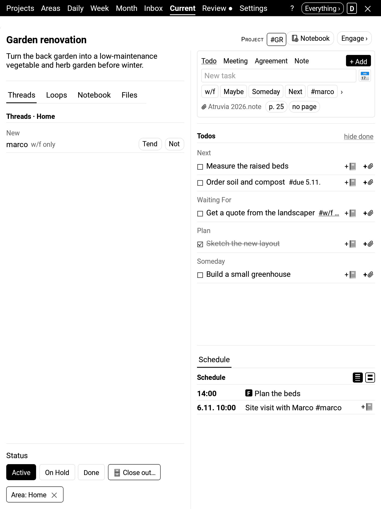
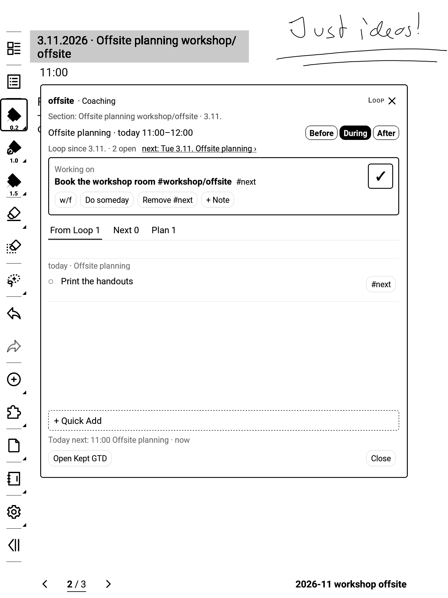
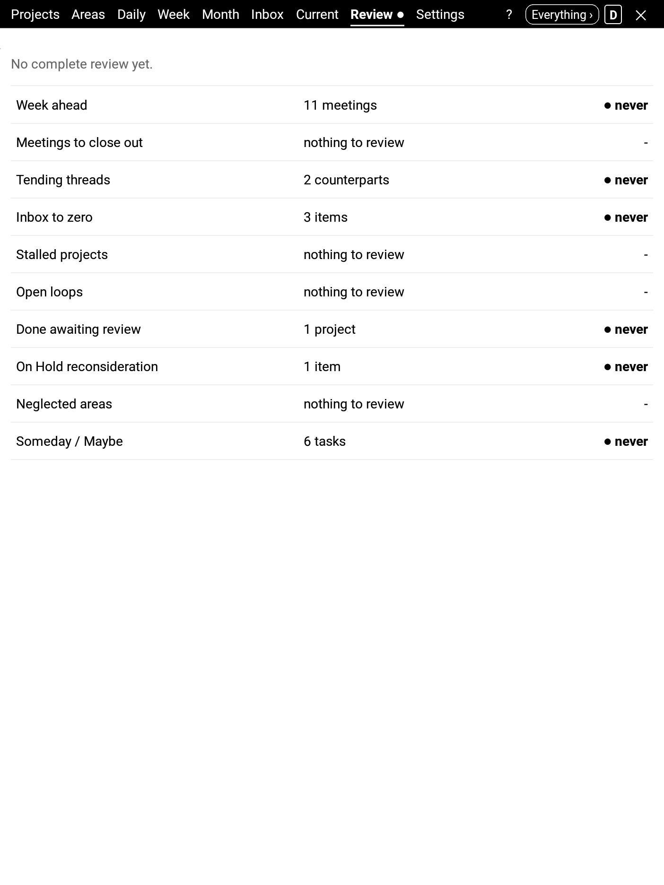

# 

*Kept GTD – for those who write, where they write.*

Your promises, kept · your todos, kept safe · your files, kept yours.

Formerly gtdpara.

**A calm GTD + PARA workspace for the Supernote.** Tasks, meetings and notes are filed as plain
text in your own Projects / Areas / Resources / Archive folders, so you can read and edit them
anywhere, with or without the plugin.

**Keep your word with people.** Most of what you promise, you promise to someone: in a 1:1, a
retro, a coaching session. Give a meeting series a nested tag such as `#sparring/jordan` and Kept GTD
keeps its thread: when you meet next, what you agreed last time, what you owe and what you are
waiting for. A project or area opens on its Threads tab, and the Weekly Review asks once a week
which people and series you still tend. See [Threads](docs/user/threads.md).

> Status: hobby project. Expect rough edges.
> Issues and ideas are welcome.

<table>
   <tr><td align="center"> Daily</td><td align="center"> Week</td><td align="center"> A project</td></tr>
   <tr><td align="center"> Engage on a note page</td><td align="center"> Weekly Review</td></tr></table>

Screenshots from the built-in demo space on a Supernote A5 X.

## Why Kept GTD

- **Your promises, kept.** Kept follows GTD and PARA: capture into the Inbox, clarify into next
  actions, organise into Projects, Areas, Resources and Archive, review once a week. Within that
  frame the structure is yours - threads, loops, tags, contexts - so you see what you promised, to
  whom and where, and decide what to keep, renegotiate, drop or focus on. Inspired by Werner
  Erhard's and Michael Jensen's work on integrity, in particular
  [Creating Leaders: An Ontological/Phenomenological Model](https://papers.ssrn.com/abstract=1681682)
  (with Kari Granger): your word is whole when you keep it or consciously renegotiate it.
- **Your files, kept yours and kept safe.** Your todos and meetings are plain text in your own
  folders, your notes are Supernote notes, and a finished project becomes one PDF with a table of
  contents, archived by year - readable without Kept, and beyond the Supernote. Kept never changes
  your files behind your back. No account, no server, no telemetry. It is open source, so anyone
  can carry it on or check what it does.
- **Well made.** Every screen is explained in the built-in help, every release says what changed and
  how to move on safely, updates keep your content and your setup, and reporting a problem is
  easy. Developed in the open, every change reviewed and tested before it reaches you.
- **Made for the Supernote: e-ink, handwriting, calm.** Paged instead of scrolled, sharp in
  greyscale. Kept builds on what the Supernote already does - notes, your templates, keywords,
  links, the lasso - and turns what you write by hand into commitments where you write it. No
  notifications, no timers, no streaks; nothing pushes the next thing at you.

These four are spelled out, with an honest rating of how well Kept keeps each today, in
[What Kept GTD promises](docs/dev/promises.md). More on the ideas behind them in
[Why Kept GTD works this way](docs/user/philosophy.md).

## Features at a glance

- **An easy start**: a setup assistant on the first start (your folders - existing ones are found,
  nothing is moved - where notes go, simple or everything, the demo space), and a Getting started
  page that walks you in
- **Threads**: tap a nested tag like `#sparring/jordan` for everything around a person, team or meeting
  series - next meetings, what you owe, what you wait for, what is relevant, what was agreed in
  past meetings and what got done since
- **Tending threads**: confirm the people and series you work with per area, see what you owe and
  wait for on a Threads tab, tend them in the Weekly Review, print "since last time" on a meeting note
- **Loops**: small projects inside an area or project, named by a tag like `#workshop/offsite` -
  one tap starts one, its todos are grouped together, it has one note from start to end, and it
  closes when nothing is open
- **Contexts** (Work, Home, Café): one chip in the tab bar filters Daily, Week, Month, Projects,
  Areas and the Weekly Review to what belongs there, and says what it hides
- **Daily, Week and Month** views with your schedule, due todos and next actions; **Given time** on
  Week and Month shows which loops, threads, projects and areas got your time
- **Focus blocks**: time for yourself in the schedule (**F**), for a loop, thread, project or area
- **The context panel**: tap a meeting and see what you owe, what is next, what you wait for and what
  was agreed last time; Quick Add straight into the meeting
- **Engage**: a second sidebar button shows a small panel over the note you work in - what you
  are working on (done, note, linked file) and the next actions of its project, area, loop or
  thread, what you owe first; what was agreed in the meeting you are in; the next meeting here
  and today; when none is left, the plan to pick from, or today's schedule
- **Meetings** with prep and review ticks and a **Reflection page** after the meeting's page - one
  handwritten page per meeting for how it went, never a todo
- **Quick Add** for todos, meetings and notes, with tags, due dates and refiling - one box of one
  height; tap a todo or meeting and its card takes the box's place, with everything you can do
  with it
- **Projects & Areas** with status, scope, abbreviations and linked files - from your folders or
  anywhere on the Supernote (`Document`, the SD card), and the PDF you are reading at its page
- **Home notebooks**: one notebook per project and area (and year), one tap away from every list -
  with a Home page (title and scope), a Notebook tab with its years and (experimental) its headings,
  and a rename offer when you renamed the folder elsewhere
- **Inbox + lasso capture** from handwriting, or **Mark for later** in one tap and process the marks later
- **Weekly Review** hub with one clear step at a time
- Works with **Obsidian** (Tasks and Dataview) through the Supernote Cloud Sync plugin
- **Note setups**: one setup per thing you keep notes about - its tags, Thread or Loop, one
  notebook or a note per item, meeting tracking, and a page layout per kind of item (or the
  Default's); notebooks can be split by tag, nested tag and date, e.g. one file per coaching client and year;
  headings for the note's table of contents and date and tag keywords make notes easy to find
- **Project close-out**: a short wizard before archiving, with an optional PDF of all notes
- **Updates from GitHub**: Kept tells you about a new release and saves it to `MyStyle/kept-gtd`,
  ready for Add plugin - by hand, or once a day if you switch it on
- Experimental **Google Calendar** (ICS link) and **Gmail** (IMAP, in the Weekly Review) integrations

The **[user guide](docs/user/index.md)** explains every view and setting, and the ideas behind
them. The same pages are built into the plugin: tap **?** in the tab bar; they link to each other. See [CHANGELOG.md](CHANGELOG.md)
for what changed in each version, including which features are still experimental.

## Install

1. Download the latest `kept-gtd-x.y.z.snplg` from
   [Releases](https://github.com/tilmanbergt/kept-gtd/releases/latest).
2. Copy it to your Supernote and install it as a new plugin. Requires Supernote's plugin firmware:
   **A5 X / A6 X Chauvet 2.27.42** or later, **Manta / Nomad Chauvet 3.30.45** or later.
   Made on the Supernote A5 X; checked in landscape and on a simulated Nomad; Manta should work.
3. Open Kept GTD from the plugin sidebar in a note; the setup assistant takes you through your
   folders.

Updating: install the newer `.snplg` over the existing one. Read the *Upgrade notes* in the
changelog first. Kept can do the fetching: **Settings → About → Check now** (or once a day, if you
switch that on) tells you about a new release and **Download** saves it to `MyStyle/kept-gtd/`.
Then close Kept and install it with **Settings → Plugins → Add plugin**; Kept never installs
anything itself. Releases on GitHub are not reviewed or approved by Ratta. You install them at
your own risk. Each release is tested to keep your data safe.

### Coming from 0.24.0 or gtdpara

Kept GTD 0.25.0 is a new install, not an update: its settings start fresh. Don't install it over
your current version. In your current Kept GTD (update to 0.24.0 first if you are on an older
version or on gtdpara), follow the 0.24.0 upgrade notes: process open lasso marks, save each
profile once, note your Gmail app password and calendar link, run **Settings → Data → Remove Kept's
data** with *Kept's data files* and *Saved profiles* unticked, then uninstall it. Then install
0.25.1 or later and open Kept: it finds your saved profile and offers to load it (**Welcome back**;
later: Settings → Data → Profiles → **Restore**). Your notes, data files and saved profiles stay
where they are.

## Help and bug reports

- Questions and ideas: [GitHub Discussions](https://github.com/tilmanbergt/kept-gtd/discussions)
- Bugs: [open an issue](https://github.com/tilmanbergt/kept-gtd/issues/new/choose) and include
  the version from Settings → About
- Contributing: see [CONTRIBUTING.md](CONTRIBUTING.md)
- Privacy and network access: see [PRIVACY.md](PRIVACY.md)

## For developers

Architecture, design documents and build instructions are in [docs/dev/](docs/dev/README.md).
Which GitHub flow to use when (test builds, merging, betas, releases): [docs/dev/GITHUB-GUIDE.md](docs/dev/GITHUB-GUIDE.md).

## License

[MIT](LICENSE) © 2026 Tilman Bergt. Built with React Native and Ratta's `sn-plugin-lib`.
Kept GTD is an independent project and not affiliated with Ratta or Supernote.
Wordmark set in Literata, SIL Open Font License 1.1.
